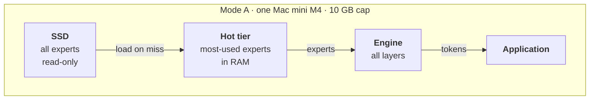
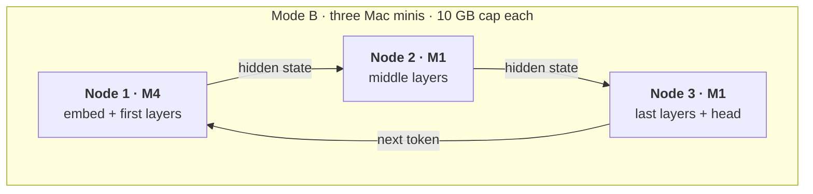

# moeflux

Pure-Rust streaming-experts Mixture-of-Experts inference for Apple
Silicon — **revamped** to run large MoE models inside a hard,
user-set memory cap, on one Mac or across a small cluster of Macs.

> **This fork is a whole-system revamp.** It keeps moeflux's engine
> and Metal kernels, and rebuilds everything around them: memory is
> governed by a strict budget, experts stream from SSD through a
> fixed-size hot tier with no OS page cache, a model can be split by
> layer range across nodes, and several requests can share the
> pipeline. The full design and phase plan is in
> [`docs/fork-upgrade-plan.md`](docs/fork-upgrade-plan.md); the
> motivation is in
> [`docs/moeflux fork proposed changes.md`](docs/moeflux%20fork%20proposed%20changes.md).
> The revamp is in progress — see [Status](#status) for what exists
> today and what is planned.

## Goals

- **Hard memory cap.** The engine never pushes total memory use past
  the cap you set (e.g. 10 GB), including page cache it would cause,
  so other services on the same machine are untouched. Everything is
  reserved at open; if it does not fit, `open` fails before anything
  else is affected.
- **Streaming experts, designed for a hard cap.** Experts stream from
  SSD with `F_NOCACHE` reads into a fixed hot tier and slot ring, with
  profile-seeded, frequency-based caching and speculative prefetch.
- **Router hook.** After routing, the engine hands each layer's
  picked experts and gate weights to a policy, which decides per
  expert whether to run it at 4-bit, run it at 2-bit, or skip it.
  The policy can live outside moeflux; the engine exposes the hook.
- **Two modes, one code path.**
  - *Mode A — single node:* Mac mini M4 24 GB, experts on an external
    SSD, 10 GB cap.
  - *Mode B — three-node pipeline:* M4 + 2 × M1 16 GB, each node runs
    a contiguous layer range with its experts resident in RAM.
- **Throughput:** several requests in flight across the pipeline.
- **Telemetry:** per token, per layer, per tier.

## Architecture

The same engine runs in both modes, always inside a hard memory cap.

### Mode A — single node, streaming

One Mac runs every layer. Experts live on the SSD; the most-used ones
sit in a fixed-size hot tier in RAM, and the rest stream in on demand.



### Mode B — three-node pipeline

Each Mac runs a slice of the layers and holds all of that slice's
experts in RAM, so nothing streams from disk. Hidden states flow from
node to node; the next token returns to the first node.



Details — memory accounts, the per-token data path, phases — are in
[`docs/fork-upgrade-plan.md`](docs/fork-upgrade-plan.md).

### Repository layout

- `crates/moeflux/` — the engine. `RsCtx` (re-exported as `Ctx`) is
  the public surface. `src/riir/` holds `backend/{cpu,gpu}`, `attn/`,
  `moe/`, `io/` (expert streaming, prefetch), `snapshot/`
  (state save/load) and `variants.rs` (compile-time model shapes).
  Kernels in `shaders/shaders.metal` are embedded via `include_str!`
  and compiled at runtime.
- `crates/moeflux-metal/` — MLX-derived quantized GEMM and gather
  kernels.
- *Planned:* `moeflux-net` (pipeline frames) and a coordinator
  binary; budget, expert-source and policy start as feature-gated
  modules inside `moeflux`.
- `scripts/` — model-prep pipeline (`extract_weights.py`,
  `export_vocab.py`, `export_tokenizer.py`).
- `tools/mlx_reference/` — MLX reference diff harness;
  `crates/moeflux/tests/mlx_regression.rs` regenerates its goldens.
- `docs/` — design notes and the upgrade plan.

## Status

**Pre-alpha**, based on moeflux `0.1.0-pre.4`.

| Area | State |
| --- | --- |
| Engine, Metal kernels, Qwen3.5-A17B / Qwen3.6-35B-A3B / Cogito-V2 variants | Exists |
| Expert streaming: mmap mode, pread + speculative prefetch, slot ring | Exists |
| Differential oracles (CPU vs Metal, batched vs per-token, MLX) | Exists |
| `OpenConfig`, `n_ctx`-sized KV, ledger, watchdog | Planned — Phase 1 |
| `F_NOCACHE` reads, fixed hot tier | Planned — Phase 2 |
| Layer-range execution | Planned — Phase 3 |
| Per-request state | Planned — Phase 4 |
| `moeflux-net`, coordinator, planner | Planned — Phase 5 |
| Streaming improvements, router policy, 2-bit | Planned — Phases 6–8 |

Build with exactly one model feature:

```bash
cargo build --features model-qwen3-6-35b-a3b
```

## Provenance

moeflux began as a fork of
[danveloper/flash-moe](https://github.com/danveloper/flash-moe) and
was rewritten in Rust by [mdegans/moeflux](https://github.com/mdegans/moeflux)
to the point of being a distinct codebase. The host-side engine is
Rust on `metal-rs`; the original C/Objective-C functions served as
differential oracles during that rewrite. The Metal
streaming-experts kernels were authored by **Claude Opus 4.6**
(Anthropic) for flash-moe and carry over here. This fork builds the
revamp described above on top of that work. The math is the same
linear algebra every inference engine runs — nothing here is
claimed as novel.

## License

MIT — see [`LICENSE`](LICENSE). See also [`CONTRIBUTORS.md`](CONTRIBUTORS.md).

## Acknowledgements

- **@danveloper** — for building the thing the hard way, writing it
  up, and publishing everything openly. moeflux started as flash-moe
  and git history reflects that.
- **@mdegans** — for the Rust rewrite this fork builds on.
- **Claude Opus 4.6** — for the Metal streaming-experts kernels and
  the architecture that made all of this run.
- **Anthropic** — for making Claude available to do work like this in
  the first place.
